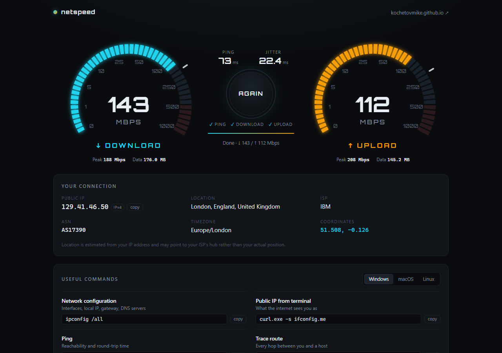

<div align="center">

# ◐ netspeed

**A tiny, dashboard-style network speed test that runs entirely in your browser.**

[](https://kochetovmike.github.io/netspeedtest/)


[](LICENSE)



</div>

## Features

- **↓ Download / ↑ Upload** on segmented digital gauges styled after a sports-car dashboard, with live readings and a marker for the highest speed reached.
- **Ping and jitter**, measured before the transfers start.
- **Your connection**: public IP, approximate location, ISP, ASN and timezone.
- **Useful commands** for Windows, macOS and Linux, each with a copy button.

## How it works

```
browser ──► speed.cloudflare.com    /__down  /__up   (parallel streams, 10 s each)
        └─► ipwho.is → ipinfo.io → geojs.io          (IP lookup, falls back down the chain)
```

There is no server-side code: GitHub Pages serves three static files, and all test traffic goes to Cloudflare's edge network. The first 25% of each test phase is left out of the result, because the connection is still speeding up during that time.

## Run locally

```sh
python -m http.server 8000   # → http://localhost:8000
```

Test settings such as duration and number of parallel streams are in `CFG` at the top of [`app.js`](app.js).

<div align="center"><sub>Made by <a href="https://kochetovmike.github.io/">Michael Kochetov</a> · MIT</sub></div>
